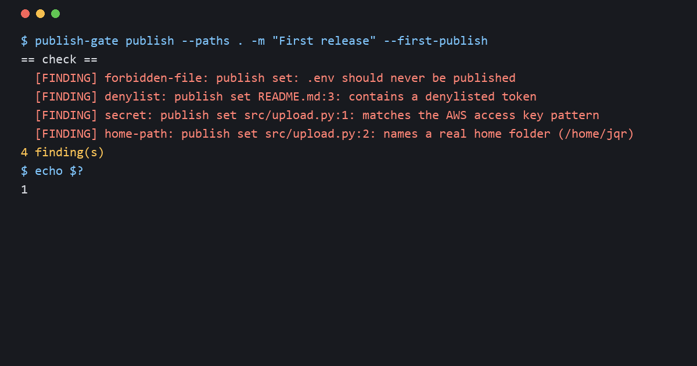

# publish-gate

A screen you run before a git repo goes public. It checks what git would actually publish, history included, for the things that leak: your name, your home folder, your personal email in commit metadata, API keys, photo location data, internal server addresses, files that should never leave your machine. Then it publishes the repo in one locked run that stops for you to read the diff before anything is pushed.

I built the first version of this for my own public repos after the token scan I was relying on called several of them clean when they were not. This is the general version, with the screens a larger codebase needs added on top of the ones I use.



## What it checks

Every check runs over the publish set (the files in the git index, which is exactly what the next commit ships, not whatever is lying in your folder) and over the history that will be pushed.

| Check | What it catches |
|---|---|
| `denylist` | Your own words: names, handles, street, employer, anything you list in a private file. File contents, file names, commit messages and author names. |
| `identity` | Commits whose author or committer email is not a public address. Your git config is checked before anything is committed. |
| `secret` | API keys, tokens, private keys. A short built-in pattern list always runs; [gitleaks](https://github.com/gitleaks/gitleaks) 8.21.2 or newer runs on top when installed, with its inline `gitleaks:allow` comments ignored. Without gitleaks the run tells you coverage is weaker. |
| `home-path` | Paths that name a real home folder on Windows, macOS or Linux. Placeholder names are allowed. |
| `email` | Email addresses in file contents, other than example domains and noreply addresses. |
| `private-ip` | Private network addresses. A warning by default, since docs often mention them on purpose. |
| `internal-host` | Domains you list as internal. |
| `image-gps` | Location metadata in photos and videos. Built in: EXIF GPS in JPEG, PNG and TIFF, and XMP location text in any of them. With [exiftool](https://exiftool.org/) installed every photo and video format is read in full. Without it, a HEIC, WebP, RAW or video file makes the run UNVERIFIABLE (set `media_without_exiftool` to `warn` to accept that). |
| `large-file` | Files over the size limit, including ones deleted long ago that still sit in history. |
| `forbidden-file` | `.env`, key files, password databases, SQLite databases, logs, OS junk. |
| `notebook-output` | Jupyter notebooks that still carry cell outputs. |
| `conflict-copy` | Sync conflict and backup copies, the `report (1).md` kind. |
| `link-preview` | A site `index.html` without the Open Graph and Twitter card tags a shared link needs: each present outside comments, with a value, and absolute URLs for the page and image. |
| `required-file` | A missing README or LICENSE. |
| `lfs` | Git LFS files. The repo holds only a pointer and LFS uploads the real file on push, so the gate cannot see it; any LFS file makes the run UNVERIFIABLE. |

Text checks read UTF-8 and UTF-16 files. In other binary files only the denylist and secret checks run, over the raw bytes. Compressed files (zip, docx, xlsx, pdf) are not unpacked: what is inside them is not checked.

Each run first plants known bad content and confirms every text check catches it. A scanner that silently stopped working looks exactly like a clean result, so a check that cannot prove it works makes the whole run UNVERIFIABLE instead of clean. The same goes for history it cannot see: a shallow clone, or a certified commit missing from the clone.

## Install

Python 3.9 or newer and git. No packages.

```
pip install git+https://github.com/dtiger1889-ops/publish-gate
```

Or copy `publish_gate.py` anywhere and run it with `python publish_gate.py`. Optional: install gitleaks and exiftool for stronger secret and metadata coverage.

Then make your denylist. It is the most personal file you own, so it lives outside every repo: by default `~/.publish-gate/denylist.txt`, or wherever the `PUBLISH_GATE_DENYLIST` environment variable points. One entry per line, matched case-insensitively anywhere in a line; lines starting with `#` are ignored. Put in what a stranger could use to find you: full name and its variants, usernames, street, workplace, the names of people in your life, project codenames. `denylist.example.txt` shows the format. A missing or empty denylist makes a run UNVERIFIABLE unless you pass `--no-denylist` on purpose.

Set your public commit email in each repo before the first commit. On GitHub that is your noreply address, shown under Settings, Emails.

```
git config user.email <your noreply address>
```

## Use

Check without changing anything:

```
publish-gate check
```

Publish a change:

```
publish-gate publish --paths src/parser.py README.md -m "Parser handles empty files"
```

That run:

1. refuses if your git email is not a public address, or if another publish-gate run is going in the same repo;
2. refuses if anything outside `--paths` has changed, counting both ends of a rename (the scope lock, so a publish never quietly takes your other work with it). Paths are relative to the repo root;
3. stages exactly those paths and runs every check, including on the commit message;
4. prints the diff since the last certified commit and stops;
5. after you have read it, run the same command with `--reviewed`. It commits, confirms the commit holds exactly the tree it checked (a commit hook could change it), screens the new commit's message and email, pushes that exact commit without tags, and certifies it.

The review stop is there because no scanner knows what is personal to you that you never thought to list. Read for names, places, real records and anyone else's data.

Certifying pins the pushed commit inside `.git/` (never published), so the next review only covers what changed since. With no pin, as on the first push or the first time you use the gate on a repo that is already pushed, the check covers all history and the review is every file. The first push to a new remote takes `--first-publish`.

A commit that reached the remote some other way can be cleared with `publish-gate certify`: it runs the same check and review stop, and pins only after `--reviewed`.

Re-check a published repo later:

```
publish-gate monitor
```

It flags a branch that moved past the certified commit (something was pushed without the gate) and checks the new history. Set `expected_visibility` and install the GitHub CLI to also confirm the repo is public or private as intended.

`publish-gate selftest` plants examples of the problems above in a throwaway repo (in current files, in a UTF-16 file, in a deleted file and in a commit's email) and confirms each check catches its own. With gitleaks installed it runs through gitleaks too. Run it after installing or upgrading.

Exit codes: 0 clean, 1 findings, 2 a check could not run, 3 stopped for review, 4 refused, 5 push failed, 6 certify failed. Anything other than 0 means do not publish.

## Settings

Optional `.publish-gate.json` in the repo root. It holds no personal data, so it can be committed. Start from `publish-gate.example.json`; every key is optional and falls back to the default in `publish_gate.py`.

| Key | Meaning |
|---|---|
| `allowed_commit_emails` | Patterns a commit email must match. Default: GitHub noreply addresses. |
| `allowed_content_emails` | Patterns an email in file contents may match. |
| `required_files` | Patterns that must each match a file. |
| `forbidden_files`, `forbidden_files_except` | File name patterns that must not ship, and the exceptions. |
| `max_file_mb` | Size limit per file. |
| `home_path_placeholders` | Folder names that count as placeholders in a home path. |
| `internal_domains` | Domains that must never appear. Keep this list here only if the names themselves are not sensitive; otherwise put them in the denylist. |
| `site_pages` | Page paths that need link-preview tags. |
| `expected_visibility` | `public` or `private`, checked by `monitor`. |
| `require_gitleaks` | Make a run UNVERIFIABLE when gitleaks is missing. Recommended for large codebases and CI. |
| `media_without_exiftool` | `unverifiable` (default) or `warn`, for photo and video formats only exiftool can read. |
| `severity` | Per check: `block`, `warn` or `off`. Unknown checks or values are refused. |
| `allow` | Exemptions for known false positives. |

An exemption names the check, a path pattern, the text on the line, and a reason:

```json
{"check": "private-ip", "path": "docs/network.md", "line_contains": "<the exact text>", "reason": "<why it is safe>"}
```

Exemptions for the text checks (`denylist`, `secret`, `home-path`, `email`, `private-ip`, `internal-host`) must carry `line_contains`, so clearing one false hit never hides the next real one. Exemptions for whole-file checks such as `large-file` or `forbidden-file` cover the matching paths. gitleaks also reads your repo's own `.gitleaks.toml` and `.gitleaksignore` if you have them.

## Larger codebases

- Turn on `require_gitleaks`. The built-in patterns are a floor, not a secret scanner.
- Run `publish-gate check --full-history` once before the first public push. Old commits are where deleted keys and big files still live.
- Run the check in CI on every push. `examples/github-actions.yml` uses a full checkout (a shallow one makes the run UNVERIFIABLE) and keeps the denylist in a repository secret, so it never sits in the repo.
- Install exiftool if the repo holds phone photos or video.
- Move LFS files out of the publish, or check them yourself and publish them some other way: the gate will not pass a repo it cannot fully see.
- If something is found in history, deleting the file in a new commit does not remove it. You need a history rewrite (for example [git filter-repo](https://github.com/newren/git-filter-repo)), and any copy already pushed should be treated as public.

## What it does not do

It does not judge dependency licences, look inside compressed files, check LFS content or publish tags, and it does not know what is sensitive to you beyond what you list. A clean run means none of the known patterns and none of your listed words were found. The review stop exists for everything else.

The lock stops two publish-gate runs from overlapping, not other programs: do not commit or stage in the repo while a publish is running. Very large histories are read in batches but held in memory while a run lasts. Files over 200 MB are not read at all, and the run says so.

Merging pull requests on the GitHub website skips every local check, and GitHub, not your git config, picks the email on the commits it writes. Merge locally instead, then publish through the gate.

Why each check exists, and what went wrong before it did: [lessons/why-each-check-exists.md](lessons/why-each-check-exists.md).

## License

MIT
